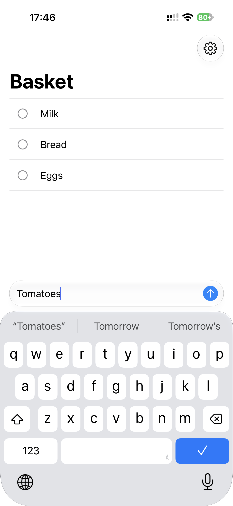
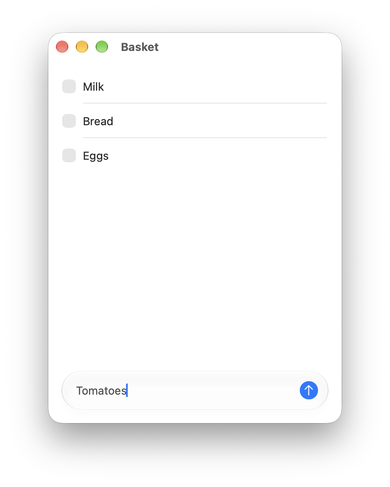
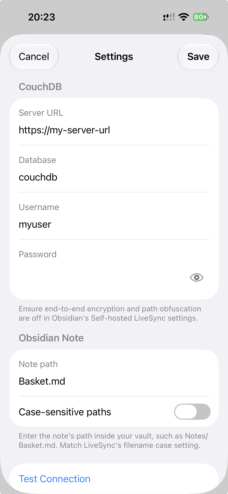
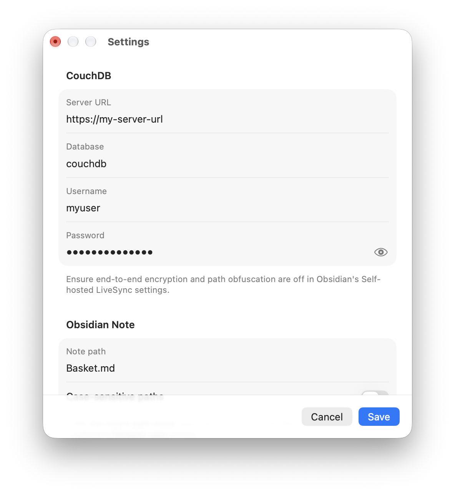

# Obsidian Basket

Minimal shopping list app for iOS and macOS that syncs with [Obsidian](https://obsidian.md/) using the same CouchDB database used by [Self-hosted LiveSync](https://github.com/vrtmrz/obsidian-livesync) plugin.

Obsidian is clunky to use on mobile, especially when shopping where I need it to be seamless and quick to open and edit my shopping list. So this app provides a dedicated and minimal interface to access my shopping list while still keeping it in my Obsidian vault.

Requires iOS 27 or later and macOS 27 or later.

> [!NOTE]
> This app is written by AI for my personal use and I haven't read the code.





## Features

- Siri and shortcuts integration
- Native undo gesture, swipe to delete, pull to refresh etc. on iOS
- Keyboard shortcuts on macOS
- Deduplication when adding same item again
- Conflict resolution with local, remote or merged lists

## How to use

To use the app, you need to have the [Self-hosted LiveSync](https://github.com/vrtmrz/obsidian-livesync) plugin installed and configured in Obsidian with a CouchDB instance. You need to use an unencrypted vault with path obfuscation disabled. Then in the app's settings, configure the credentials and connection details for the CouchDB database.

The app will then be able to read and write to your Obsidian vault seamlessly. Any changes made in the app will be reflected in your Obsidian vault and vice versa.





## Development

The project requires Xcode 27.1 or later.

Open the project and select the `ObsidianBasket` scheme:

```sh
open ObsidianBasket.xcodeproj
```

To run on a device or sign a macOS build, create `Config/Local.xcconfig` with your signing team and a unique bundle identifier:

```xcconfig
DEVELOPMENT_TEAM = YOUR_TEAM_ID
PRODUCT_BUNDLE_IDENTIFIER = com.yourname.obsidian-basket
```

Keep your signing settings in this file. It's ignored by Git, and you can use the same settings for Debug and Release builds.

You can build for macOS and the iOS Simulator without signing:

```sh
xcodebuild -project ObsidianBasket.xcodeproj \
  -scheme ObsidianBasket \
  -configuration Debug \
  -destination 'generic/platform=macOS' \
  -derivedDataPath .build/macos \
  CODE_SIGNING_ALLOWED=NO build

xcodebuild -project ObsidianBasket.xcodeproj \
  -scheme ObsidianBasket \
  -configuration Debug \
  -destination 'generic/platform=iOS Simulator' \
  -derivedDataPath .build/ios \
  CODE_SIGNING_ALLOWED=NO build
```

To check a Release build, replace `-configuration Debug` with `-configuration Release`. For static analysis, replace `build` with `analyze`.
